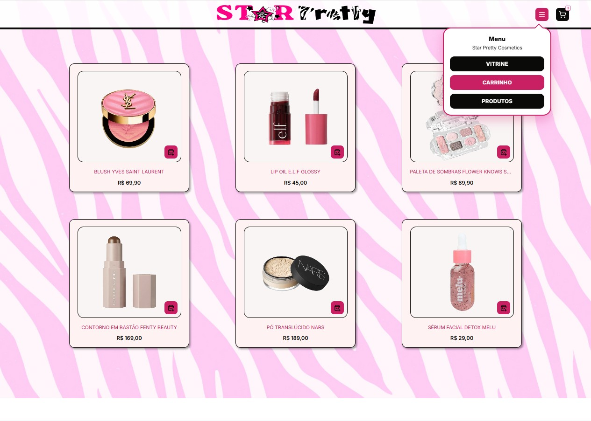
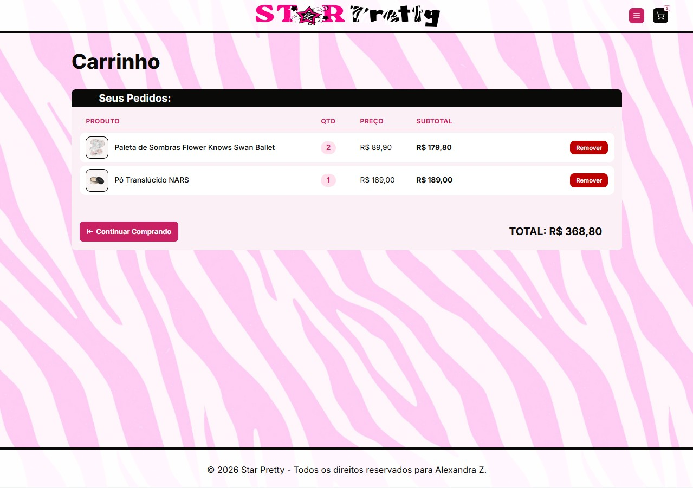
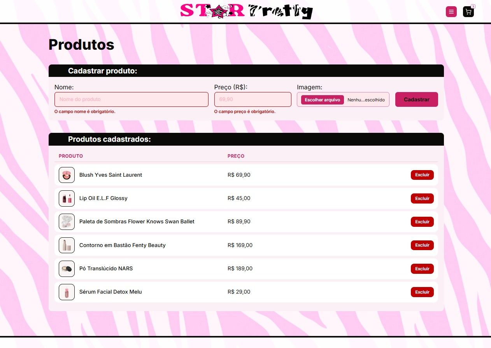

<p align="center">
  
</p>

<h3 align="center">🩷 Vitrine de cosméticos em Laravel 🩷</h3>

<p align="center">
  
  
  
  
</p>

<p align="center">
  Projeto de <b>Desenvolvimento WEB II</b> — o sistema MVC em PHP da <b>Star Pretty</b> reconstruído no Laravel,<br>
  com as páginas <b>vitrine</b> e <b>carrinho</b> e os exercícios do <b>slide 48</b> (do MVC ao Laravel).
</p>

---

## 💄 Conheça o site

### Vitrine
Produtos em cards, menu suspenso e botão de adicionar ao carrinho (o contador do ícone atualiza sem recarregar a página).

<p align="center">
  
</p>

### Carrinho
Itens, quantidades, subtotais e total. Cada item pode ser removido.

<p align="center">
  
</p>

### Produtos (CRUD)
Cadastro com upload de imagem, validação com mensagens e listagem com exclusão.

<p align="center">
  
</p>

---

## ✨ Funcionalidades

- 🛍️ **Vitrine** com os produtos vindos do banco de dados
- 🛒 **Carrinho** guardado na sessão (não precisa de login), com total calculado
- ➕ **Cadastro de produtos** com nome, preço (aceita `69,90`) e imagem enviada do computador
- ✅ **Validação** com `@error` e mensagens em português
- 🗑️ **Exclusão** de produtos (apaga também o arquivo da imagem)
- 🎬 Seção de tutorial com vídeo

## 🧭 Rotas

| Método | URL | Nome | Controller |
|:--:|---|---|---|
| `GET` | `/` | `vitrine` | `VitrineController@index` |
| `GET` | `/carrinho` | `carrinho.index` | `CarrinhoController@index` |
| `POST` | `/carrinho/{produto}` | `carrinho.adicionar` | `CarrinhoController@adicionar` |
| `DELETE` | `/carrinho/{id}` | `carrinho.remover` | `CarrinhoController@remover` |
| `GET` | `/produtos` | `produtos.index` | `ProdutoController@index` |
| `POST` | `/produtos` | `produtos.store` | `ProdutoController@store` |
| `DELETE` | `/produtos/{produto}` | `produtos.destroy` | `ProdutoController@destroy` |

## 📋 Exercício do slide 48

- [x] **Migration** da tabela principal → `database/migrations/..._create_produtos_table.php`
- [x] **Model Eloquent** com `$fillable` → `app/Models/Produto.php`
- [x] **Controller** com `index()` e `store()` → `app/Http/Controllers/ProdutoController.php`
- [x] **Rotas nomeadas** no `web.php` → `routes/web.php`
- [x] **Layout Blade + menu em `partials/`** → `resources/views/layout.blade.php` e `partials/menu.blade.php`
- [x] **Formulário** com `@csrf`, validação e `@error` → `resources/views/produtos/index.blade.php`
- [x] **Listagem** com `@forelse` → `produtos/index.blade.php` e `vitrine.blade.php`
- [x] **Desafio extra:** excluir com `Route::delete`, `@method('DELETE')` e `$produto->delete()`

## 🗂️ Estrutura

```
app/
├── Http/Controllers/   → VitrineController, CarrinhoController, ProdutoController
└── Models/Produto.php
database/
├── migrations/         → tabela produtos
└── seeders/            → 6 produtos da Star Pretty
resources/views/
├── layout.blade.php
├── partials/           → menu e rodapé
├── vitrine.blade.php
├── carrinho.blade.php
└── produtos/index.blade.php
routes/web.php
public/                 → css, js, img, fonts e video
```

## 🚀 Como rodar

```bash
composer install
cp .env.example .env          # no Windows: copy .env.example .env
php artisan key:generate
```

Crie o banco **`star_pretty`** no MySQL (phpMyAdmin) e confira `DB_USERNAME` e `DB_PASSWORD` no `.env`. Depois:

```bash
php artisan migrate --seed
php artisan serve
```

Acesse **http://localhost:8000** 🩷

## 🎨 Paleta


---

<p align="center">
  Feito com 🩷 por <b>Alexandra Z.</b><br>
  <sub>Técnico em Análise e Desenvolvimento de Sistemas — FAI Centro Universitário de Adamantina</sub>
</p>
